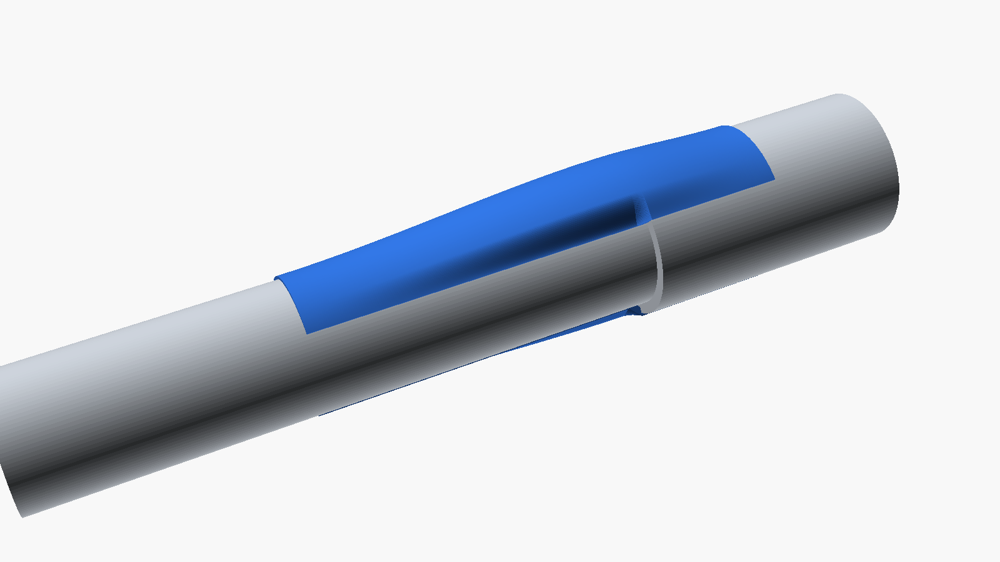
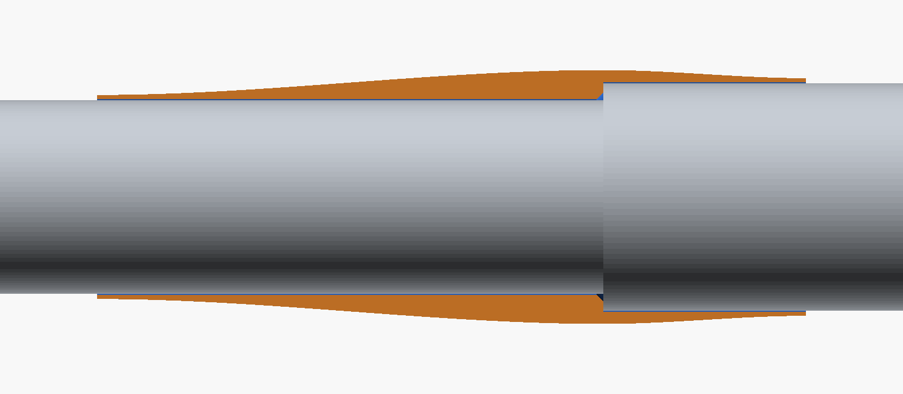
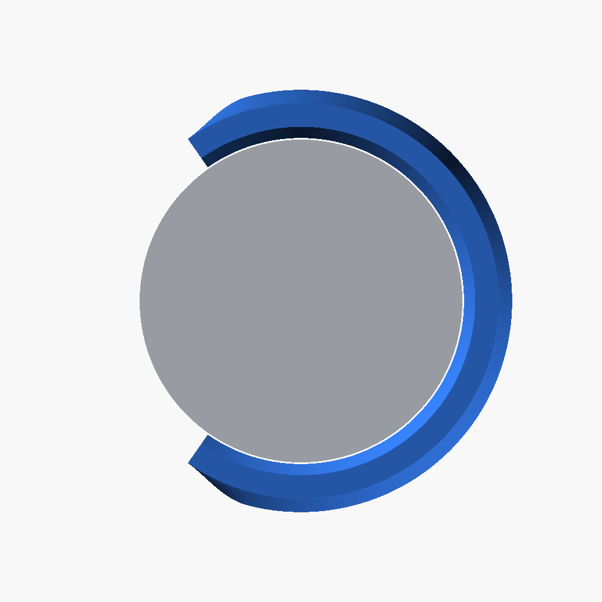
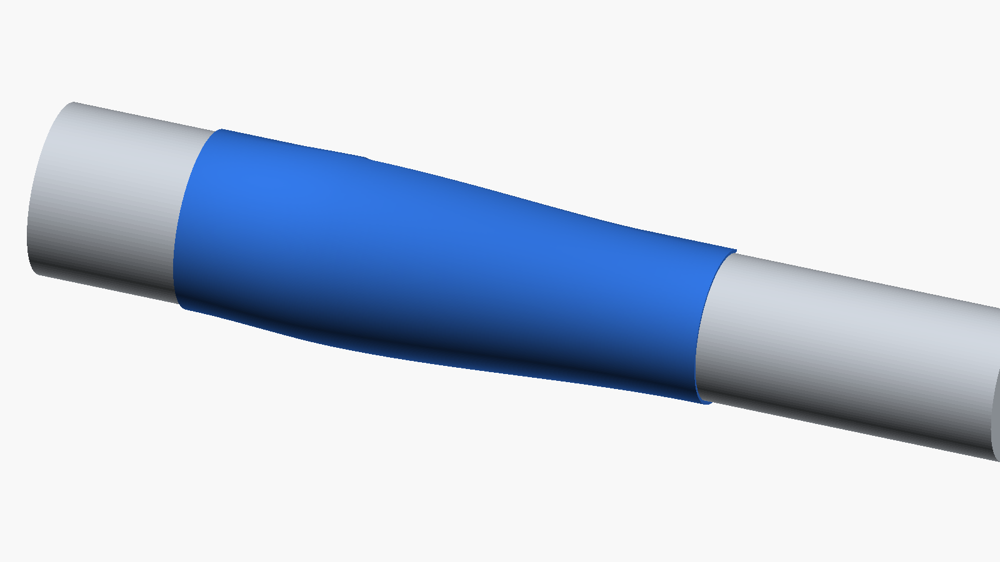
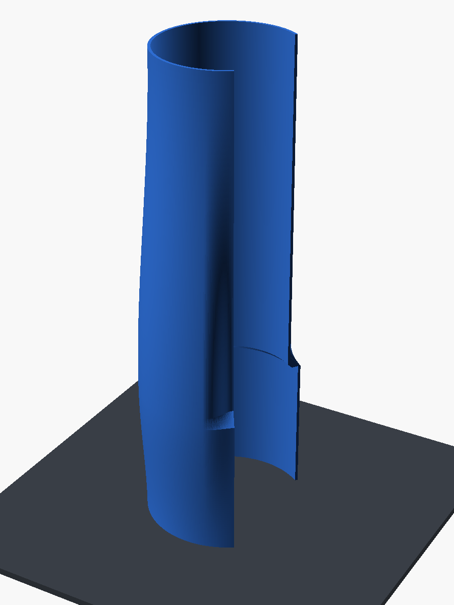

# Curtain Rod Ramp Adapter

A 3D-printable clip that lets curtain rings slide smoothly over the joint of a telescoping curtain rod, where the thin rod goes into the thick tube.



> **Status:** version 2. Version 1 was printed and tested, and the lessons are built into this version. Version 2 hasn't been tested on the rod yet. See [HANDOFF.md](HANDOFF.md) for the full history and notes.

## The problem

On a telescoping curtain rod, the thin rod slides into a thick tube. The thick tube's rim is a step about 1.7 mm high, and curtain rings catch on it when you pull the curtain from the thin rod onto the thick tube.

## How it works



*Cut in half lengthwise: thin rod on the left, thick tube on the right, adapter walls in orange.*

- **Ramp:** a 50 mm curved slope on the thin rod lifts the rings up and over the rim. It starts almost flat and is never steeper than about 4°.
- **Stop:** a flat ledge inside butts against the thick tube's rim, so rings pushing on the ramp can't shove the adapter onto the thick tube.
- **Sleeve:** a 20 mm sleeve wraps over the rim and tapers down onto the thick tube.
- **Clip:** C-shaped, so it snaps on from the side while the rod stays on the wall, and pulls off by hand. The opening faces the room and the rings ride over the closed top.
- **Thin edges:** every edge the rings or the rod slide over is 0.4 mm thick, one line with a 0.4 mm nozzle. The edge the rings meet on the thin rod drops from 1.66 mm to 0.5 mm.

| Looking along the rod | From the wall side |
|---|---|
|  |  |

## Sizes (as set up in the file)

| | Inches | mm |
|---|---|---|
| Thick tube, outside diameter | 0.8865 | 22.52 |
| Thin rod, outside diameter | 0.7555 | 19.19 |
| Curtain ring, inside diameter | 1.2075 | 30.67 |
| Adapter, widest diameter | 0.989 | 25.12 |
| Length (ramp + sleeve) | 2.76 | 70 |

These are for one specific rod. **Measure yours** and change them before printing (see below).

## Fit it to your rod

Open `curtain_rod_ramp.scad` in [OpenSCAD](https://openscad.org/). Every setting is at the top of the file and also appears in OpenSCAD's Customizer panel.

| Setting | Default | What it does |
|---|---|---|
| `outer_tube_dia_in` | 0.8865 | Thick tube outside diameter, in inches. |
| `inner_rod_dia_in` | 0.7555 | Thin rod outside diameter, in inches. |
| `ring_inner_dia_in` | 1.2075 | Ring inside diameter, in inches. Only used to check that the adapter clears the rings. |
| `fit_clearance` | 0.2 | Added to the rod diameters for the clip's bore, in mm. Lower it (to 0, then negative) if the clip slides on the rod. |
| `snap_opening` | 0.82 | Clip opening as a fraction of the bore. Lower grips harder but is harder to snap on. |
| `ramp_length` | 50 | Ramp length in mm. |
| `sleeve_length` | 20 | Sleeve length in mm. |
| `sleeve_wall` | 1.2 | Wall thickness over the rim, the thickest point, in mm. |
| `edge_wall` | 0.4 | Thickness of every thin edge, in mm. |
| `opening_taper_angle` | 20 | How far around from each opening edge the wall thins, in degrees. |
| `stop_ledge_width` | 1.0 | Width of the flat stop that butts against the rim, in mm. |

Press F5 to preview: see-through rods show how it sits, and they're never exported. The console lists the widest diameter, the clearance inside the rings, the edge heights, the slope angles and the print height. If the adapter would be wider than the rings, the file stops with a message instead of exporting.

Export the STL from the OpenSCAD menu, or run this from the command line:

```
openscad --export-format binstl -o curtain_rod_ramp.stl curtain_rod_ramp.scad
```

## Printing



- **Orientation:** standing on the sleeve end, exactly as exported. No supports.
- **Material:** PLA, 0.4 mm nozzle.
- **Brim:** outer brim, about 8 mm wide, with a 0.1 mm gap so it snaps off cleanly. The base is only 0.4 mm wide and the part is 70 mm tall, so the brim matters. Clean off any burr left on the sleeve end, or the rings will catch on it.
- **Elephant foot compensation:** about 0.15 mm, so the first layer doesn't flare the sleeve's end edge.
- **Walls:** use the Arachne wall generator, which prints the thin edges and changing wall thickness cleanly. Use enough wall loops (7) that the part is all outline lines, with no infill.

**Bambu Lab A1:** `curtain_rod_ramp.3mf` is a ready-made Bambu Studio project with these settings. It uses the A1 with a 0.4 mm nozzle, Bambu PLA Basic, the Textured PEI plate and Bambu's 0.16mm Optimal profile. Open it as a project. It slices in about 37 minutes using 5.6 g of PLA.

Bambu Studio warns that the object "has floating regions". This is a false alarm caused by the one-line-wide base: the first layer prints a full ring under the layers above it. Leave supports off.

<br clear="right">

## Installing

1. Hold the adapter with its opening facing the room.
2. Push it onto the thin rod next to the joint until it snaps on.
3. Slide it toward the thick tube until the stop inside meets the rim. The sleeve goes over the end of the thick tube.

## Files

| File | What it is |
|---|---|
| `curtain_rod_ramp.scad` | The OpenSCAD model, with every setting at the top. |
| `curtain_rod_ramp.stl` | Ready to slice, standing upright for printing. |
| `curtain_rod_ramp.3mf` | Bambu Studio project for the A1 (see Printing). |
| `HANDOFF.md` | Design notes, history and known issues. |
| `images/` | The pictures in this README. `sh images/render.sh` re-renders them from `images/views.scad`. |

## License

[CC BY 4.0](LICENSE): you can use, change and share this design, including commercially, as long as you give credit.
